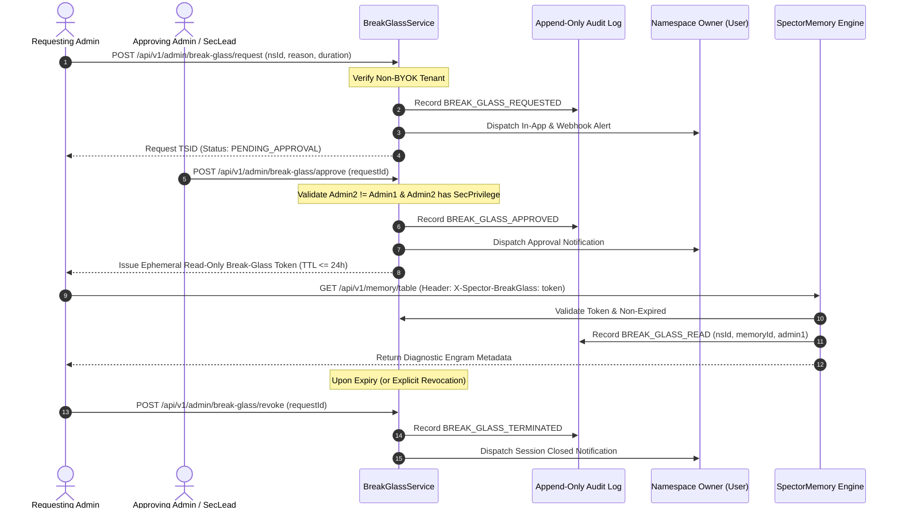

# ADR-0087: Admin Role Model, Content-Free Admin API Contract & Break-Glass Policy

| Field | Value |
|:---|:---|
| **Status** | Proposed |
| **Date** | 2026-10-13 |
| **Authors** | Spector Maintainers & Architecture Working Group |
| **Deciders** | Spector Technical Steering Committee (TSC) |
| **Supersedes** | None |
| **Superseded By** | None |
| **Last Verified** | 2026-10-13 (Verified against `main`) |

---

## 1. Context

Spector serves as a zero-overhead cognitive memory engine for autonomous AI agents and multi-tenant applications. Unlike traditional key-value caches or document stores, Spector persists and indexes rich cognitive constructs across working, episodic, semantic, and procedural memory stores. These include engram observations, high-dimensional vector embeddings, emotional valence distributions, associative Hebbian co-activation graphs, and episodic conversation histories.

With the completion of **Phase 0: Security Foundation** under [Epic #1047](https://github.com/spectrayan/spector/issues/1047), Spector established the foundational mechanisms for multi-tenant isolation and security:
- **Dynamic Request Tenant Resolution** ([ADR-0070](0070-unified-error-taxonomy-and-exception-handling.md), Issue [#1048](https://github.com/spectrayan/spector/issues/1048), PR [#1075](https://github.com/spectrayan/spector/pull/1075)): Authenticated tenant ID is resolved directly from JWT claims (`tenant_id`, configurable OIDC claim `spector.auth.oidc.tenant-claim`) and API-key principals into request context (`ScopedValue` and Spring `SecurityContext`), eliminating legacy hardcoded `"default"` tenant stubs and rejecting cross-tenant namespace access with HTTP 403 and `SPE-SEC-xxx` error taxonomy.
- **Role-Based Access Control & Scope Gating** (Issue [#1049](https://github.com/spectrayan/spector/issues/1049), PR [#1076](https://github.com/spectrayan/spector/pull/1076)): `SpectorRoles` (`super-admin`, `admin`, `editor`, `agent`, `viewer`) and `SpectorScopes` (`admin:*`, `tenant:*`, `namespace:*`, `memory:*`) were promoted from Javadoc constants to active Spring Security authorities. Mutating infrastructure endpoints (`/api/v1/admin/cache`, dynamic config, tasks, providers) were secured with `@PreAuthorize`.
- **Universal Credentials Vault & IDOR Remediation** (Issue [#1050](https://github.com/spectrayan/spector/issues/1050), PR [#1078](https://github.com/spectrayan/spector/pull/1078)): Deprecated `api_keys` tables were retired in favor of the universal `credentials` vault (`/api/v1/credentials`) with AES-256-GCM envelope encryption and strict credential ownership checks preventing IDOR vulnerabilities.
- **Content-Free Observability Sanitization** (Issue [#1051](https://github.com/spectrayan/spector/issues/1051), PR [#1079](https://github.com/spectrayan/spector/pull/1079)): Observability endpoints (`/api/v1/observability/timeline`, `/traced-recall`, `/vector-space/projection`) were scrubbed of memory text and raw labels, and backed by ArchUnit bytecode contract tests (`ContentFreeObservabilityContractTest`).
- **Fail-Closed Encryption Gating** (Issue [#1052](https://github.com/spectrayan/spector/issues/1052), PR [#1082](https://github.com/spectrayan/spector/pull/1082)): Production deployments fail closed if `SPECTOR_MASTER_ENCRYPTION_KEY` is missing or invalid.
- **Cortex UI Authentication & Role Guards** (Issue [#1053](https://github.com/spectrayan/spector/issues/1053), PR [#1083](https://github.com/spectrayan/spector/pull/1083)): Angular Cortex UI was equipped with a standalone `/login` route, automatic `Bearer` token injection with background refresh and retry, `authGuard`, and `roleGuard('admin', 'super-admin')`.

As Spector embarks on **Phase 1: Content-Free Admin APIs & Policies** (Issues [#1055](https://github.com/spectrayan/spector/issues/1055)–[#1061](https://github.com/spectrayan/spector/issues/1061)) and **Phase 2: Cortex UI Restructure** (Issues [#1062](https://github.com/spectrayan/spector/issues/1062)–[#1068](https://github.com/spectrayan/spector/issues/1068)), there is an urgent need for an authoritative Architecture Decision Record defining:
1. The two-tier administrative hierarchy.
2. The zero-knowledge **Content-Free Admin Privacy Contract**.
3. The **Dual-Persona Principle** governing administrator interactions with their own namespaces.
4. The governed **Emergency Break-Glass Policy & Protocol** (and its strict rejection for BYOK tenants).
5. The unified multi-channel boundary enforcement across REST, Web UI, Agentic tools, and MCP servers.

---

## 2. Problem Statement

Cognitive memories contain confidential autobiographical facts, intimate conversational transcripts, strategic reasoning steps, and proprietary business context. Exposing these engrams to administrative scrutiny introduces existential privacy, regulatory, and security risks:

1. **The Insider Threat & Operator Surveillance Risk**: In traditional database or cloud architectures, "system administrators" possess unrestricted `SELECT *` privileges across all customer tables. In a cognitive memory system, granting platform operators or tenant administrators unrestricted memory recall enables surveillance of private human conversations and proprietary AI agent trajectories.
2. **Regulatory & Compliance Invalidation**: Enterprise customers operating under GDPR, HIPAA, SOC 2 Type II, and ISO 27001 cannot adopt Spector if administrative roles implicitly grant access to end-user cognitive data.
3. **Operational Visibility vs. Content Snooping**: Infrastructure operators genuinely need visibility into operational metrics—cluster node health, memory tier capacity, recall latency percentiles, error distributions, and quota consumption. However, none of these operational capabilities require reading memory text, high-dimensional vector arrays, or raw engram metadata.
4. **Emergency Diagnostics vs. Zero-Knowledge Guarantees**: When a production corruption, index desynchronization, or memory loop occurs, support engineers may require emergency troubleshooting access. Without a formal, auditable break-glass protocol, teams either build ad-hoc backdoor queries or compromise security boundaries. Conversely, for Bring Your Own Key (BYOK) tenants who hold external KMS keys, break-glass must be strictly prohibited both by policy and by cryptographic impossibility.
5. **Channel Inconsistency & Scope Bleed**: In modern agentic architectures, memory is accessed across multiple vectors: REST APIs, Web UIs (Cortex), internal agentic tool loops, and external Model Context Protocol (MCP) servers (`crates/ebb-mcp`, `synapse/spector-mcp`). If security boundaries are enforced only at the UI layer or only on REST controllers, administrative users or autonomous agents could bypass isolation via alternative ingress channels.

---

## 3. Decision Drivers

- **Zero-Knowledge Content-Free Invariant**: Under no circumstances may any `/api/v1/admin/**` endpoint, administrative service, or admin dashboard return memory text, vectors, labels, tags, unmasked secrets, or raw metadata payloads.
- **Two-Tier Administrative Hierarchy**: Enforce a strict separation between Platform Operators (`super-admin`), who govern fleet-wide infrastructure and cross-tenant capacity, and Tenant Administrators (`admin`), who govern accounts, agent principals, and quotas strictly within their assigned tenant.
- **Dual-Persona Principle**: Administrators are also regular users. An administrator role grants zero implicit access to memory contents. To remember, recall, or inspect associative graphs, an administrator must act as a regular user within the User Workspace (`/`) on namespaces they personally own or have been explicitly granted via `GrantRole`.
- **Cryptographic Zero-Knowledge for BYOK**: For tenants with Bring Your Own Key (BYOK) encryption enabled, emergency break-glass is strictly rejected by policy and cryptographically impossible once customer-managed KMS key management is activated.
- **Governed Emergency Break-Glass for Non-BYOK**: For standard (non-BYOK) tenants, provide a time-boxed ($\le 24$ hours, default 60 minutes), read-only, dual-authorized, owner-notified, and tamper-evidently audited emergency break-glass mechanism.
- **Multi-Channel Boundary Parity**: Security invariants must apply identically across all ingestion and recall surfaces: REST endpoints, Cortex Angular UI, Agentic diagnostic playgrounds, and MCP tool servers (`memory_remember`, `memory_recall`, `memory_reinforce`, `memory_dream`).
- **Automated Architectural Contract Verification**: Invariants must be enforced by automated ArchUnit bytecode tests and integration canary tests in CI/CD to prevent regressions.

---

## 4. Considered Options

### Option 1: Monolithic Superuser Model (Traditional Database Pattern)
- **Description**: Administrative roles (`admin`, `super-admin`) are treated as database superusers with blanket read/write permissions across all tenant data and memory tables (`/memory/table`, recall, search).
- **Advantages**: Simple implementation; operators have unrestricted access for troubleshooting and debugging.
- **Disadvantages**: Completely violates zero-knowledge privacy; fails enterprise SOC 2 and GDPR compliance; exposes cognitive data to insider threats; unacceptable to enterprise customers.

### Option 2: Single-Tier Admin with Soft/Unregulated Break-Glass
- **Description**: A single `admin` role manages both tenant configuration and fleet operations. Admins can self-authorize break-glass access to any namespace without secondary approval or owner notification.
- **Advantages**: Lower operational friction during incidents; fewer administrative entities.
- **Disadvantages**: Blurs boundaries between multi-tenant hosting providers and enterprise tenants; self-approval of break-glass invites abuse and insider snooping; lacks real-time owner alerting.

### Option 3: Two-Tier Scoped Admin with Content-Free Contract, Strict Non-BYOK Dual Break-Glass, and Automated Architectural Verification (Selected)
- **Description**: Formal two-tier role separation (`super-admin` Platform Operator vs. `admin` Tenant Admin). All `/api/v1/admin/**` endpoints are verified content-free by ArchUnit contract tests. Content access is strictly gated by namespace grants. Break-glass requires dual-control approval, is time-boxed, notifies the owner, logs to an append-only audit trail, and is strictly disabled for BYOK tenants.
- **Advantages**: Uncompromising privacy; satisfies SOC 2, HIPAA, and GDPR; clear division of responsibility between platform host and tenant administrators; automated regression protection; zero content exposure in administrative dashboards.
- **Disadvantages**: Requires secondary approver during emergencies for non-BYOK tenants; requires rigorous DTO separation in backend controllers.

---

## 5. Decision Outcome

**Chosen Option**: **Option 3: Two-Tier Scoped Admin with Content-Free Contract, Strict Non-BYOK Dual Break-Glass, and Automated Architectural Verification**.

```
                     ┌──────────────────────────────────────────────────────────┐
                     │                  Platform Operator                       │
                     │                    (super-admin)                         │
                     │   • Fleet-wide tenant management & global config         │
                     │   • Cluster, SIMD/GPU telemetry & cross-tenant quotas    │
                     │   • Content Access: NEVER (Break-glass non-BYOK only)    │
                     └────────────────────────────┬─────────────────────────────┘
                                                  │
                                                  ▼
                     ┌──────────────────────────────────────────────────────────┐
                     │                    Tenant Admin                          │
                     │                      (admin)                             │
                     │   • Single-tenant accounts, agent principals & quotas    │
                     │   • Namespace lifecycle, KMS status, tenant config       │
                     │   • Content Access: NEVER (Break-glass non-BYOK only)    │
                     └────────────────────────────┬─────────────────────────────┘
                                                  │
                        ┌─────────────────────────┴─────────────────────────┐
                        ▼                                                   ▼
         ┌──────────────────────────────┐                    ┌──────────────────────────────┐
         │         User (editor)        │                    │     Agent Principal (agent)  │
         │  • Owns & manages namespaces │                    │  • Autonomous AI agent       │
         │  • Remember, recall, graph   │                    │  • Access limited to granted │
         │  • Content Access: YES       │                    │    namespaces via REST & MCP │
         │    (Own/granted namespaces)  │                    │  • Content Access: YES       │
         └──────────────────────────────┘                    └──────────────────────────────┘
```

---

### 5.1 Two-Tier Administrative Hierarchy & Authorization Matrix

Spector enforces two distinct administrative tiers alongside standard application principals:

| Principal Role | Scope & Boundary | Permitted Administrative Responsibilities | Content Access |
|:---|:---|:---|:---:|
| **Platform Operator**<br/>(`super-admin`) | Fleet-wide<br/>(All tenants) | Tenant lifecycle (`/api/v1/admin/tenants`), global system configuration, cluster node orchestration, GPU/SIMD hardware acceleration telemetry, fleet-wide quota allocation. | **NEVER**<br/>*(Except emergency dual-approved break-glass on non-BYOK)* |
| **Tenant Admin**<br/>(`admin`) | Single Tenant<br/>(`SecurityUtils.getTenantId()`) | Account lifecycle, autonomous agent principal registry, tenant-level namespace quotas, namespace lifecycle (archive, legal hold, verified erasure), tenant KMS status. | **NEVER**<br/>*(Except emergency dual-approved break-glass on non-BYOK)* |
| **User**<br/>(`editor`, `viewer`) | Namespace Grant<br/>(`accountId` / grants) | Personal/team cognitive memory management: remember, recall, reflective dream triggers, associative graph exploration, namespace sharing. | **YES**<br/>*(Strictly on owned/granted namespaces)* |
| **Agent Principal**<br/>(`agent`) | Namespace Grant<br/>(`accountId` / grants) | Automated ingestion and contextual recall via REST and MCP tools for executing agentic workflows. | **YES**<br/>*(Strictly on granted namespaces)* |

#### Spring Security Enforcement Rules
1. Platform Operator endpoints are guarded by `@PreAuthorize("hasRole('super-admin')")`.
2. Tenant Admin endpoints are guarded by `@PreAuthorize("hasAnyRole('admin', 'super-admin')")`.
3. In every Tenant Admin controller method, the target `tenantId` is strictly extracted from `SecurityUtils.getTenantId()`. A Tenant Admin attempting to query or mutate a resource belonging to another tenant receives `HTTP 403 Forbidden` with error code `SPE-SEC-001`.
4. Platform Operators may explicitly target a specific tenant by providing `?tenantId=` or `X-Tenant-ID`. If omitted, operations default to fleet-wide scope.

---

### 5.2 Content-Free Admin Privacy Contract

All responses emitted by controllers located in `com.spectrayan.spector.synapse.admin.*` or serving administrative functions must adhere to the **Content-Free Contract**.

#### Permitted Fields (Aggregate Telemetry & Metadata)
Administrative responses may only contain:
- **Numerical Aggregates**: Memory counts per tier (`WORKING`, `EPISODIC`, `SEMANTIC`, `PROCEDURAL`), total storage bytes, capacity utilization percentages, ingestion/recall operations per second, consolidation frequency, error counts.
- **Latency & Performance Metrics**: p50, p95, p99 recall latency, similarity score distribution averages, active inference free-energy rates.
- **Structural Metadata**: Namespace slugs, 13-character TSID resource identifiers (`user_id`, `tenant_id`, `account_id`, `namespace_id`, `agent_id`), timestamps (`created_at`, `last_active_at`, `expires_at`), lifecycle status flags (`ACTIVE`, `SUSPENDED`, `ARCHIVED`, `LEGAL_HOLD`).
- **Cryptographic & Key Metadata**: Key provider types (`AWS_KMS`, `VAULT`, `LOCAL`), key aliases, key versions, rotation schedules, and verification checksums. (Never raw secrets or key material).

#### Strictly Banned Content Fields
Administrative responses **must never** contain:
- `text` (Engram observation or conversation text).
- `vector`, `quantizedVector`, `rawEmbedding` (High-dimensional embedding arrays).
- `label` (Human-readable text labels derived from engram content).
- `tags` (Semantic or synaptic tag arrays that leak conceptual topics).
- `metadata`, `properties`, `attributes` (Unfiltered user-provided payload maps).
- `rawSecret`, `secret`, `ciphertext`, `keyHash` (Security credentials).

#### Contract Test Enforcement
This contract is continuously enforced by ArchUnit structural tests in `synapse/spector-synapse` (`ContentFreeObservabilityContractTest` and `ContentFreeAdminContractTest`):
```java
@Test
void adminDtosMustNotDeclareContentFields() {
    Set<String> bannedFieldNames = Set.of(
        "text", "vector", "quantizedvector", "payload",
        "tags", "label", "rawsecret", "secret", "ciphertext"
    );
    for (var clazz : adminClasses) {
        if (clazz.getPackageName().contains(".dto")) {
            for (JavaField field : clazz.getFields()) {
                assertThat(bannedFieldNames)
                    .as("Admin DTO %s declares forbidden content field '%s'", clazz.getName(), field.getName())
                    .doesNotContain(field.getName().toLowerCase());
            }
        }
    }
}
```

---

### 5.3 Dual-Persona Principle (Admin Personal Namespaces)

A common architectural error is assuming administrators never produce or consume memories. In Spector:
1. **Administrators are also users**: An individual holding the `admin` or `super-admin` role possesses a user account (`UserAccount`).
2. **Role separation at the UI and API layer**:
   - When accessing the **Admin Console** (`/admin`), the administrator manages infrastructure, quotas, accounts, and fleet health. No memory contents are accessible.
   - When accessing the **User Workspace** (`/`), the administrator acts as a standard `editor`. They can remember, recall, and explore associative graphs **exclusively within namespaces they own or have been explicitly granted**.
3. **No Implicit Grant**: An administrator attempting to call `/api/v1/memory/table` or `/api/v1/memory/recall` against a namespace owned by another account without an explicit `GrantRecord` receives `HTTP 403 Forbidden` (`SPE-SEC-001`). Administrative roles grant zero content bypass.

---

### 5.4 Emergency Break-Glass Policy & Protocol

In rare production emergencies (e.g., severe associative graph corruption, runaway prompt injection loops, index partition desynchronization), human intervention may be required to inspect memory state.



#### Break-Glass Rules & Invariants
1. **BYOK Absolute Prohibition**:
   - If `tenant.byok_enabled == true`, any break-glass request is immediately rejected with `HTTP 403 Forbidden` (`SPE-SEC-001: Break-glass is strictly disabled for zero-knowledge BYOK tenants`).
   - For BYOK tenants, customer data is encrypted with a Key Encryption Key (KEK) held in the customer's KMS. Spector operators cannot decrypt the data without customer key provision.
2. **Dual-Authorization Workflow**:
   - A single administrator cannot self-approve break-glass.
   - Approval requires a second distinct administrator or designated Security Officer (`Admin2 != Admin1`).
3. **Strict Time-Boxing**:
   - The session TTL must be specified at request time (default: 60 minutes, maximum permissible cap: 24 hours).
   - Once expired, the ephemeral token is revoked immediately in-memory and in cache.
4. **Read-Only Scope**:
   - Break-glass grants strictly `READ_ONLY` diagnostic inspection. Under no circumstances may a break-glass session mutate, inject, or delete memory engrams.
5. **Real-Time Owner Notification**:
   - Upon request, approval, and session closure, automated notifications are dispatched via SSE to the Cortex UI and external customer webhooks.
6. **Immutable Audit Trail**:
   - Every break-glass event (Request, Approval, Rejection, Access, Expiry, Revocation) and every engram accessed during the session is logged to the append-only audit stream with timestamp, caller TSID, client IP, and justification.

---

### 5.5 Ingress & Channel Boundary Enforcement

Security boundaries apply uniformly regardless of how memory is accessed:

```
  ┌────────────────────────────────────────────────────────────────────────┐
  │                         Unified Ingress Gate                           │
  ├────────────────────────────────────────────────────────────────────────┤
  │ 1. Resolve Principal: UserRow + SpectorRoles + SpectorScopes           │
  │ 2. Resolve Tenant: SecurityUtils.getTenantId() (Strict Isolation)      │
  │ 3. Resolve Target Namespace: Ownership check OR active GrantRecord     │
  └───────────────────────────────────┬────────────────────────────────────┘
                                      │
        ┌─────────────────────────────┼─────────────────────────────┐
        ▼                             ▼                             ▼
┌───────────────┐             ┌───────────────┐             ┌───────────────┐
│   REST API    │             │   Cortex UI   │             │   MCP Tools   │
│  Controllers  │             │   Workspaces  │             │ (ebb/synapse) │
└───────┬───────┘             └───────┬───────┘             └───────┬───────┘
        │                             │                             │
        └─────────────────────────────┼─────────────────────────────┘
                                      ▼
                        ┌───────────────────────────┐
                        │ SpectorMemory Core Engine │
                        │  (Zero Content Leakage)   │
                        └───────────────────────────┘
```

1. **REST Endpoints**: Filter chains enforce `TenantNamespaceFilter` and `@PreAuthorize`.
2. **Cortex UI**: `authGuard` verifies authentication; `roleGuard` gates `/admin/**`; `CortexStateService` binds `currentNamespace` to `X-Spector-Namespace`.
3. **Agentic Playground**: Diagnostic chat and tool invocation harnesses are demoted to `/playground` (disabled by default) and run strictly within the user's bound namespace.
4. **Model Context Protocol (MCP)**: Both standalone `crates/ebb-mcp` and Java `synapse/spector-mcp` tools (`memory_remember`, `memory_recall`, `memory_reinforce`, `memory_dream`) enforce namespace bounds, refusing cross-tenant or ungranted access.

---

### 5.6 Interplay with ADR-0083 and Upcoming BYOK ADR

1. **Amending ADR-0083 (Namespace-Isolated Analytics)**:
   - [ADR-0083](0083-namespace-isolated-memory-analytics-telemetry.md) established per-namespace metrics (`spector.namespace` tag) and `/api/v1/memory/stats`.
   - ADR-0087 extends ADR-0083 by authorizing **Fleet-Wide** and **Tenant-Wide** aggregate rollups for administrative telemetry (Issue [#1058](https://github.com/spectrayan/spector/issues/1058)). Meters will carry `spector.tenant` tags in addition to `spector.namespace`.
   - ADR-0083 status transitions from `Proposed` to `Accepted (Amended by ADR-0087)`.
2. **Foundation for BYOK Envelope Encryption (ADR-0088 / Issue #1069)**:
   - This ADR establishes the policy invariant that BYOK tenants are zero-knowledge and immune to break-glass.
   - The upcoming ADR-0088 (Issue [#1069](https://github.com/spectrayan/spector/issues/1069)) specifies the cryptographic engine: per-namespace Data Encryption Keys (DEKs), external KMS Key Encryption Keys (KEKs) across AWS KMS, GCP KMS, Azure Key Vault, and HashiCorp Vault, and instant crypto-shredding on key revocation.

---

## 6. Pros and Cons of the Options

| Evaluation Criterion | Option 1: Monolithic Superuser | Option 2: Single-Tier Soft Break-Glass | Option 3: Two-Tier Content-Free + Dual Break-Glass (Selected) |
|:---|:---:|:---:|:---:|
| **Zero-Knowledge Privacy** | ❌ None (Admins see everything) | ⚠️ Weak (Single admin can snoop) | ✅ **Complete (Zero content in admin surfaces)** |
| **Compliance Readiness (SOC 2, GDPR, HIPAA)** | ❌ Fails compliance audit | ⚠️ High audit friction | ✅ **Auditor-ready with automated ArchUnit gates** |
| **BYOK Zero-Knowledge Guarantee** | ❌ Incompatible | ❌ Incompatible | ✅ **Strict break-glass rejection on BYOK** |
| **Separation of Duties** | ❌ No distinction between host and tenant | ⚠️ Partial distinction | ✅ **Strict separation (`super-admin` vs `admin`)** |
| **Incident Diagnostic Capability** | ✅ Unrestricted | ✅ Fast (No dual approval) | ✅ **Governed (Dual approval, time-boxed, audited)** |
| **Blast Radius of Compromised Admin Credential** | ❌ Total leak of all memory engrams | ⚠️ Broad compromise | ✅ **Restricted to metadata; zero engram content** |
| **Implementation Complexity** | Low | Medium | High (Requires rigorous DTO separation and ArchUnit rules) |

---

## 7. Implementation Plan

The decisions in this ADR are implemented across Phase 1 and Phase 2 of Epic #1047:

1. **Phase 1: Content-Free Admin APIs & Policies (Backend)**:
   - **Issue [#1055](https://github.com/spectrayan/spector/issues/1055)**: Implement Tenant Management API (`/api/v1/admin/tenants`) for `super-admin` with aggregate counts only.
   - **Issue [#1056](https://github.com/spectrayan/spector/issues/1056)**: Implement Admin Account & Agent-Principal Registry (`/api/v1/admin/accounts`, `/agents`) for `admin` and `super-admin`.
   - **Issue [#1057](https://github.com/spectrayan/spector/issues/1057)**: Implement Admin Namespace Lifecycle (fleet/tenant list, quotas, archive, legal hold, verified erasure via `TenantErasureService`).
   - **Issue [#1058](https://github.com/spectrayan/spector/issues/1058)**: Implement Content-Free Aggregated Analytics API (`/api/v1/admin/analytics`) with tenant/fleet rollups.
   - **Issue [#1059](https://github.com/spectrayan/spector/issues/1059)**: Implement Append-Only Audit Log for administrative mutations and break-glass events.
   - **Issue [#1060](https://github.com/spectrayan/spector/issues/1060)**: Implement Break-Glass Protocol (dual-authorization state machine, non-BYOK gating, ephemeral tokens, webhook alerts).
   - **Issue [#1061](https://github.com/spectrayan/spector/issues/1061)**: Bind MCP & Agentic memory tools to caller's own or granted namespaces.

2. **Phase 2: Cortex UI Restructure (Frontend)**:
   - **Issue [#1062](https://github.com/spectrayan/spector/issues/1062)**: Implement Role-Aware Shell separating `/admin` Console from `/` User Workspace; remove dead links.
   - **Issue [#1063](https://github.com/spectrayan/spector/issues/1063)**: Implement Reactive Namespace Switcher binding `currentNamespace` to `X-Spector-Namespace`.
   - **Issue [#1064](https://github.com/spectrayan/spector/issues/1064)**: Build Admin Console pages: Overview, Tenants, Accounts & Agents, Namespaces.
   - **Issue [#1065](https://github.com/spectrayan/spector/issues/1065)**: Build Admin Analytics Dashboards (fleet/tenant/namespace, content-free).
   - **Issue [#1066](https://github.com/spectrayan/spector/issues/1066)**: Build Admin Infra, Audit Log, and Break-Glass management pages.
   - **Issue [#1067](https://github.com/spectrayan/spector/issues/1067)**: User Workspace cleanup (own-namespace memory operations, sharing, settings).
   - **Issue [#1068](https://github.com/spectrayan/spector/issues/1068)**: Demote Chat to `/playground` (off by default); add Remember/Recall diagnostic console.

---

## 8. Code Reference & Verification

- **Primary Subsystems**:
  - `synapse/spector-synapse`: `com.spectrayan.spector.synapse.admin.*`, `security.*`, `observability.*`
  - `nucleus/spector-commons`: `com.spectrayan.spector.commons.security.SpectorRoles`, `SpectorScopes`
  - `synapse/spector-mcp` & `crates/ebb-mcp`: MCP tool namespace gating
  - `cortex/spector-cortex`: `app/features/admin/*`, `core/guards/*`, `core/services/auth.service.ts`

- **Key Verification Tests**:
  - `synapse/spector-synapse/src/test/java/com/spectrayan/spector/synapse/observability/ContentFreeObservabilityContractTest.java`: ArchUnit rules verifying that observability DTOs declare zero content fields.
  - `synapse/spector-synapse/src/test/java/com/spectrayan/spector/synapse/security/SecurityConfigAuthorizationGatingTest.java`: Verifies `@PreAuthorize` role gating across all endpoints.
  - `synapse/spector-synapse/src/test/java/com/spectrayan/spector/synapse/security/SecurityUtilsTest.java`: Verifies tenant resolution and cross-tenant isolation.
