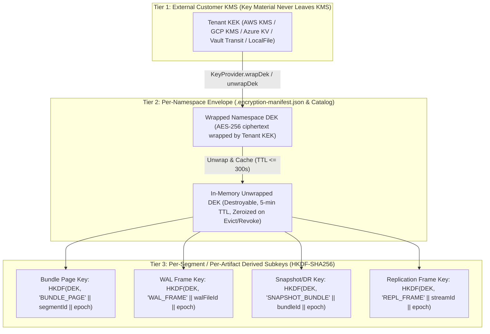
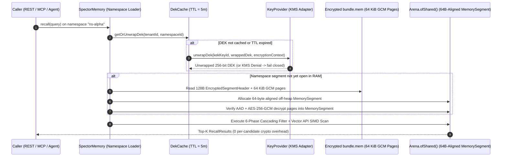
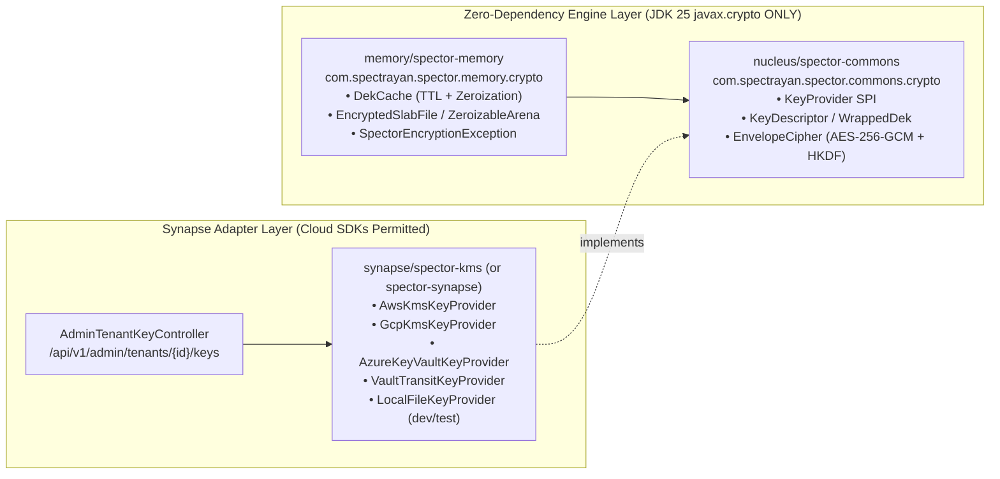

# ADR-0088: Bring Your Own Key (BYOK) & Per-Tenant Envelope Encryption of the Memory Store

| Field | Value |
|:---|:---|
| **Status** | Accepted |
| **Date** | 2026-10-18 |
| **Authors** | Spector Maintainers & Architecture Working Group |
| **Deciders** | Spector Technical Steering Committee (TSC) |
| **Supersedes** | None (Amends [ADR-0004](0004-mmap-bundle-architecture-and-fd-scaling.md), [ADR-0083](0083-namespace-isolated-memory-analytics-telemetry.md), [ADR-0087](0087-admin-role-model-content-free-contract-break-glass.md)) |
| **Superseded By** | None |
| **Last Verified** | 2026-10-18 (Verified against `main` @ `d7258105`) |

---

## 1. Context

Spector persists high-salience cognitive constructs across working, episodic, semantic, and procedural memory tiers, including raw observation text, structured entity-relation graphs, synaptic tags, emotional valence vectors, and high-dimensional embedding vectors (`float32` and `int8`/`int4` quantized codes).

In [ADR-0087: Admin Role Model, Content-Free Admin API Contract & Break-Glass Policy](0087-admin-role-model-content-free-contract-break-glass.md), Spector established the **Zero-Knowledge Content-Free Admin Privacy Contract**:
- Platform Operators (`super-admin`) and Tenant Administrators (`admin`) are prohibited from reading memory content through administrative APIs (`/api/v1/admin/**`).
- For standard (non-BYOK) tenants, emergency troubleshooting is governed by a dual-authorized, time-boxed, read-only, owner-notified **Break-Glass** protocol ([Issue #1060](https://github.com/spectrayan/spector/issues/1060)).
- For **Bring Your Own Key (BYOK)** tenants, break-glass is **unconditionally denied** (`SPE-SEC-009`), and zero-knowledge isolation must be enforced **cryptographically** so that neither platform operators nor host-infrastructure administrators can decrypt tenant memories on disk, in backups, or after customer key revocation.

### Current Baseline on `main` (Audited at `d7258105`)

An audit of the repository confirms that **memory payloads and vectors are not yet encrypted at rest**:
1. **`SpectorEncryptionException` Is Unreferenced**: [`SpectorEncryptionException`](../../memory/spector-memory/src/main/java/com/spectrayan/spector/memory/error/SpectorEncryptionException.java) (`SPE-310-019`) exists in `memory/spector-memory` but has zero throw sites across the engine.
2. **`V1_0_to_V1_1_EncryptionMarker` Is a No-Op Stub**: [`V1_0_to_V1_1_EncryptionMarker`](../../memory/spector-memory/src/main/java/com/spectrayan/spector/memory/persist/migration/migrations/V1_0_to_V1_1_EncryptionMarker.java) only writes a `.encryption-ready` file containing `{"encryptionEnabled": false, "reason": "lazy-migration"}` without encrypting any segment or slab bytes.
3. **Vault-Only Cipher**: [`AesGcmCipher`](../../synapse/spector-synapse/src/main/java/com/spectrayan/spector/synapse/security/crypto/AesGcmCipher.java) derives per-tenant keys via `HKDF-SHA256` from a single platform master key (`SPECTOR_MASTER_ENCRYPTION_KEY`) and exclusively protects the universal `credentials` table (`/api/v1/credentials`).
4. **Plaintext Storage & Transport Surfaces**: Memory bundles (`bundle.mem`), tiered segment files, Write-Ahead Logs (`wal/*.bin`), point-in-time snapshots, cluster replication frames, and disaster-recovery bundles ([`SpectorBundleCodec`](../../synapse/spector-batch/src/main/java/com/spectrayan/spector/batch/SpectorBundleCodec.java)) store engram text, metadata, synaptic tags, and vector embeddings in plaintext.

This ADR defines the normative architecture for **Phase 3 of [Epic #1047](https://github.com/spectrayan/spector/issues/1047)** (Issues [#1069](https://github.com/spectrayan/spector/issues/1069)–[#1074](https://github.com/spectrayan/spector/issues/1074)): per-tenant BYOK envelope encryption of the Spector memory store.

---

## 2. Problem Statement

Designing application-layer BYOK envelope encryption for a zero-overhead, SIMD-accelerated cognitive memory engine introduces seven core engineering challenges:

1. **Vector Inversion Vulnerability**: High-dimensional embeddings (`float32`, `int8` scalar-quantized, or product-quantized codes) and synaptic tag strings are **not** safe to leave in plaintext on disk. State-of-the-art vec2text / embedding-inversion models reconstruct 70–95% of source tokens from raw vectors, and OS-level disk encryption (`LUKS`, `EBS`, `BitLocker`) only protects against physical drive theft—not against a cloud host or platform operator with root access to mounted volumes or snapshot archives.
2. **Preserving 6-Phase Scanner & SIMD Throughput**: Spector's recall pipeline ([ADR-0072](0072-six-phase-fused-cognitive-scoring-pipeline.md), [ADR-0073](0073-recall-cognitive-pathway-multi-phase-retrieval.md)) relies on 64-byte cache-line-aligned `EncodingHeader` slabs (`MemorySegment`) and Java Vector API (`jdk.incubator.vector`) SIMD intrinsics scanning tens of thousands of candidates in microseconds. Invoking `Cipher.doFinal` per engram during a scan would degrade recall latency by $100\times$–$1{,}500\times$.
3. **Multi-Tier Key Hierarchy & Blast-Radius Containment**: A customer's external KMS Key Encryption Key (**KEK**) cannot be called on every memory write (due to KMS network latency of 5–30 ms and strict API rate limits) and must never expose raw key material outside the KMS boundary. At the same time, sharing a single Data Encryption Key (**DEK**) across an entire tenant prevents granular per-namespace crypto-shredding and risks AES-GCM nonce exhaustion across high-velocity segments.
4. **Plaintext Residency & Off-Heap Zeroization**: Java `MemorySegment` arenas (`Arena.ofShared()`) and `byte[]` arrays retain decrypted bytes in RAM until overwritten. If a tenant revokes their KEK or a namespace is evicted/closed, residual plaintext and unwrapped DEKs must be deterministically zeroized in memory.
5. **Comprehensive Artifact Coverage**: Encryption cannot stop at `bundle.mem`. Any auxiliary persistence or transport channel—WAL frames, HNSW/BM25 index snapshots, cluster replication frames, and `.spector` DR export bundles (`SpectorBundleCodec`)—would leak plaintext if left unencrypted.
6. **Zero-Dependency Engine Invariant**: Per `AGENTS.md` Architectural Invariant #1, `nucleus/spector-commons`, `nucleus/spector-core`, `memory/spector-kernel`, and `memory/spector-memory` must have **zero third-party runtime dependencies** (JDK 25 standard library only). Cloud KMS SDKs (`software.amazon.awssdk:kms`, `com.google.cloud:google-cloud-kms`, `com.azure:azure-security-keyvault-keys`, Vault HTTP client) must be strictly isolated from the core engine modules.
7. **KMS Outage vs. Customer Key Revocation (Crypto-Shredding)**: The engine must define deterministic, fail-closed semantics when a customer disables or revokes their KEK in AWS/GCP/Azure/Vault KMS, while bounding the window of cached DEK availability via a strict Time-To-Live (TTL).

---

## 3. Decision Drivers

- **Cryptographic Zero-Knowledge for BYOK Tenants**: On-disk files, backups, WALs, and replication streams for a BYOK namespace must contain **zero plaintext bytes** of engram text, metadata, tags, or vectors/quantized codes.
- **Sub-Millisecond Warm Recall Budget**: Warm recall p99 latency on an open encrypted namespace must stay within **$\le 5\%$ overhead** compared to plaintext recall by preserving contiguous 64-byte-aligned off-heap `MemorySegment` layouts for the 6-phase scanner and Vector API SIMD kernels.
- **Zero External Dependencies in Engine Modules**: The `KeyProvider` SPI and `EnvelopeCipher` engine primitives must use `javax.crypto` (`AES/GCM/NoPadding`, `HkdfParameterSpec` / `HmacSHA256`) from standard JDK 25 only.
- **Instantaneous Cryptographic Erasure (Crypto-Shredding)**: Destroying a namespace's wrapped DEK or revoking a tenant's KMS KEK must immediately render all historical segments, WALs, and backups permanently undecryptable without requiring multi-gigabyte disk rewrites.
- **Deterministic Nonce & AAD Binding**: Prevent AES-GCM nonce reuse and cross-namespace/cross-segment ciphertext splicing (cut-and-paste attacks) via structured Associated Authenticated Data (AAD) and monotonic/HKDF-derived nonces.
- **Content-Free Administrative & Analytics Compatibility**: Aggregate tenant/namespace telemetry ([ADR-0083](0083-namespace-isolated-memory-analytics-telemetry.md)) and admin key-health views ([Issue #1073](https://github.com/spectrayan/spector/issues/1073)) must operate without exposing decrypted memory contents.

---

## 4. Considered Options

### Option 1: OS / Volume-Level Encryption Only (`LUKS` / `AWS EBS` / `BitLocker`)
- **Description**: Delegate encryption of `bundle.mem` and vector segments to the underlying filesystem or cloud block volume, applying application-layer AES-GCM only to `text.dat` and credentials.
- **Advantages**: Zero application code complexity for mmap segments; transparent OS page-cache decryption.
- **Disadvantages**: **Fails the BYOK threat model.** Platform operators (`super-admin`) with host/container access read decrypted bytes transparently from the mounted filesystem; vectors, synaptic tags, and `EncodingHeader` attributes remain in plaintext to the application host; per-tenant customer KMS revocation and per-namespace crypto-shredding are impossible on shared block volumes.

### Option 2: Per-Engram On-the-Fly Decrypt During 6-Phase Recall Scan
- **Description**: Memory-map ciphertext directly from `bundle.mem` and decrypt each candidate engram's header and vector inside Phase 1–5 of the recall loop using `Cipher.doFinal`.
- **Advantages**: Plaintext never resides in long-lived off-heap buffers; minimal memory footprint on namespace open.
- **Disadvantages**: **Catastrophic hot-path latency regression.** Decrypting 100,000 candidate headers and 768-dim vectors per query adds 15–35 ms of JCE allocation and GCM authentication overhead per query, destroying Spector's sub-millisecond SLA and preventing contiguous Vector API SIMD loads.

### Option 3: Three-Tier Envelope Encryption with Decrypt-on-Open Off-Heap Segments, Write-Through Page Encryption, and Bounded-TTL DEK Cache (Selected)
- **Description**:
  1. Use a 3-tier envelope hierarchy: **Customer KMS KEK (Tenant)** $\rightarrow$ **Wrapped Namespace DEK (AES-256)** $\rightarrow$ **HKDF-SHA256 Per-Segment / Per-Artifact Data Key (SDK)**.
  2. Encrypt **all** persisted bytes on disk—text, metadata, tags, `EncodingHeader` slabs, float/quantized vectors, WAL frames, snapshots, replication frames, and DR bundles—in 64 KiB authenticated pages/frames using `AES-256-GCM`.
  3. When an authorized caller opens a namespace, unwrap the Namespace DEK via `KeyProvider` (cached in memory with a strict 5-minute TTL and explicit zeroization) and decrypt segment pages into 64-byte-aligned `Arena.ofShared()` off-heap `MemorySegment` buffers.
  4. Execute the 6-phase cascading filter-then-scan loop and SIMD vector kernels directly over the off-heap `MemorySegment` at full native speed; encrypt dirty pages and WAL records on write-through flush.
- **Advantages**:
  - 100% of on-disk bytes (including vectors and headers) are AES-256-GCM ciphertext authenticated with tenant/namespace AAD.
  - Warm recall latency overhead is $\approx 0\%$ ($\le 5\%$ p99 budget) because SIMD kernels scan contiguous off-heap `MemorySegment` slabs in RAM.
  - Supports instant per-namespace and per-tenant crypto-shredding, zero-downtime KEK rotation (rewrap DEKs only), and background DEK rotation via `SpectorTaskQueue`.
- **Disadvantages**:
  - Cold namespace open incurs a one-time KMS unwrap ($\sim 5$–$25\text{ ms}$) plus AES-NI segment decryption ($\sim 3\text{ ms}$ per $300\text{ MiB}$ at $10\text{ GiB/s}$).
  - Active namespaces hold decrypted segments in `Arena.ofShared()` off-heap RAM (mitigated by explicit `MemorySegment.fill((byte) 0)` zeroization on close, eviction, TTL expiry, or KEK revocation).

---

## 5. Decision Outcome

**Chosen Option**: **Option 3: Three-Tier Envelope Encryption with Decrypt-on-Open Off-Heap Segments, Write-Through Page Encryption, and Bounded-TTL DEK Cache**.

### 5.1 Three-Tier Envelope Key Hierarchy



1. **Tier 1 — Customer-Managed Tenant KEK (`TenantKeyConfig`)**:
   - Each tenant can operate in `PLATFORM_MANAGED` mode (using a tenant-scoped KEK derived from `SPECTOR_MASTER_ENCRYPTION_KEY` via HKDF) or **`BYOK` mode** (referencing an external KMS key URI/ARN such as `arn:aws:kms:...`, `gcpkms://projects/...`, `azurekv://...`, or `vault://transit/keys/...`).
   - Raw KEK bytes **never** enter Spector's JVM memory for external KMS providers; Spector invokes remote `Encrypt`/`WrapKey` and `Decrypt`/`UnwrapKey` APIs over TLS using credentials stored in the universal credentials vault (`/api/v1/credentials`).
2. **Tier 2 — Per-Namespace DEK (`NamespaceDekRecord`)**:
   - Every encrypted namespace is assigned a cryptographically random 256-bit `NamespaceDEK` (`SecureRandom.getInstanceStrong()`).
   - The raw `NamespaceDEK` is wrapped by the tenant's active KEK via `KeyProvider.wrapDek(...)` and persisted as `wrappedDek` alongside `kekProvider`, `kekKeyId`, `kekVersion`, `dekId`, `dekVersion`, and `algorithm = "AES-256-GCM-HKDF-SHA256"` in both the namespace's `.encryption-manifest.json` and the `NAMESPACE_ENCRYPTION_KEY` catalog table.
3. **Tier 3 — Per-Segment / Per-Artifact Data Keys (`SDK`)**:
   - To eliminate AES-GCM 96-bit nonce collision risk across concurrent files and segment compactions, the `NamespaceDEK` is never used directly with `Cipher`.
   - Instead, each segment, WAL file, snapshot, or DR bundle derives an isolated 256-bit **Segment Data Key (`SDK`)** and a 32-bit **Nonce Salt (`NSALT`)** via RFC 5869 `HKDF-SHA256`:
     $$\text{PRK} = \text{HMAC-SHA256}(\text{salt} = \text{segmentRandomSalt}_{16\text{B}}, \text{IKM} = \text{NamespaceDEK})$$
     $$\text{SDK}_{32\text{B}} \parallel \text{NSALT}_{4\text{B}} = \text{HKDF-Expand}(\text{PRK}, \text{info} = \text{tenantId} \parallel \text{namespaceId} \parallel \text{artifactType} \parallel \text{segmentId} \parallel \text{dekVersion}, 36)$$
   - Each 64 KiB page or WAL frame $i$ encrypted under $\text{SDK}$ uses a deterministic, strictly unique 96-bit (12-byte) IV/nonce:
     $$\text{Nonce}_{12\text{B}} = \text{NSALT}_{4\text{B}} \parallel \text{uint32\_be}(\text{writeGeneration}) \parallel \text{uint32\_be}(\text{pageOrFrameIndex})$$
   - Because $(\text{writeGeneration}, \text{pageOrFrameIndex})$ is strictly monotonic per flush/frame and $\text{segmentRandomSalt}_{16\text{B}}$ is regenerated on every new segment or full compaction, `(SDK, Nonce)` pairs are provably unique across the lifetime of the namespace.

---

### 5.2 What Is Encrypted (Complete Coverage Invariant)

For any encrypted namespace (and mandatorily for all namespaces in a BYOK tenant), **all cognitive content and structural representations on disk are encrypted**:

| Storage / Transport Artifact | Encrypted Payload Scope | Plaintext Header / Metadata Allowed on Disk |
|:---|:---|:---|
| **`bundle.mem` & Tiered Segments (`*.mem`, `*.seg`)** | **All** 64-byte `EncodingHeader` slabs (timestamps, valence, importance, synaptic tag Bloom filters), `text.dat` blocks, metadata JSON, `float32` vectors, `int8`/`int4` quantized HNSW/PQ codes, and Hebbian/entity adjacency lists. | 128-byte `EncryptedSegmentHeader` only (magic, schema version `V1.2`, flags, `dekId`, `dekVersion`, `segmentId`, `pageSize`, `pageCount`, `segmentSalt`). |
| **Write-Ahead Log (`wal/wal-*.bin`)** | Entire serialized mutation payload (engram text, tags, vectors, reinforcement deltas, delete tombstones). | Frame envelope header (`frameLength`, `frameSeq`, `writeGeneration`, `dekVersion`, 12-byte nonce, 16-byte GCM tag). |
| **Index Files (`*.hnsw`, `*.bm25`, `*.midx`)** | All quantized vector codes, neighbor lists, BM25 term dictionaries, and posting lists. | 128-byte `EncryptedSegmentHeader`. |
| **Snapshots & Backups** | All segment and index pages plus `.encryption-manifest.json` (containing only `wrappedDek`, never raw DEK). | Snapshot manifest metadata (timestamp, byte size, engram count, `dekId`, `kekKeyId`). |
| **Cluster Replication Frames** | Replicated WAL/segment frames remain encrypted under the namespace's `SDK` (or re-encrypted over mTLS with AAD validation). | Routing envelope (`tenantId`, `namespaceId`, `frameSeq`, `dekVersion`). |
| **DR / Portability Bundles (`SpectorBundleCodec`)** | All memory entries, vectors, and graph edges inside `.spector` export bundles are encrypted in a `SEC1` (`Spector Encrypted Container v1`) envelope when exported from a BYOK namespace. | Container header (`SEC1` magic, `tenantId`, `namespaceId`, `dekId`, `kekKeyId`, `recordCount`). |

#### Associated Authenticated Data (AAD) Binding

Every `AES-256-GCM` encryption and decryption operation binds structured binary AAD to the 128-bit GCM authentication tag:

```
AAD = UTF8(tenantId) || 0x00
   || UTF8(namespaceId) || 0x00
   || uint8(artifactType)
   || uint16_be(schemaVersion = 0x0102)
   || UUID_bytes(dekId)
   || uint64_be(segmentIdOrLogSeq)
   || uint32_be(writeGeneration)
   || uint32_be(pageOrFrameIndex)
```

If an attacker or storage bug copies an encrypted page from Namespace A to Namespace B, swaps page indices within a segment, or replays an older WAL frame into a different segment, `AEADBadTagException` is immediately caught and translated into `SpectorEncryptionException(ErrorCode.MEMORY_AUTH_TAG_MISMATCH, ...)` (`SPE-310-020`).

---

### 5.3 Hot-Path Execution: Decrypt-on-Open into `Arena.ofShared()` Off-Heap Memory



1. **Why Decrypt-on-Open Wins on the Recall Hot Path**:
   - Spector's `EncodingHeader` is a 64-byte cache-line-aligned off-heap struct (`MemorySegment`), and Phase 5 SIMD kernels (`Cosine`, `L2`, `DotProduct`) load vectors directly via `FloatVector.fromMemorySegment(...)` / `ByteVector.fromMemorySegment(...)`.
   - When a namespace is opened, `EncryptedSlabFile` reads the on-disk 64 KiB AES-256-GCM pages, verifies each page's 128-bit GCM tag against its AAD, and writes the decrypted bytes into an anonymous, non-file-backed off-heap `Arena.ofShared()` `MemorySegment` (aligned to 64 bytes).
   - Once loaded into the off-heap `MemorySegment`, the 6-phase cascading scanner and Java Vector API SIMD intrinsics execute at **100% native memory speed** with zero per-candidate cipher invocations.
2. **Write-Through Dirty-Page Flush & WAL Append**:
   - On `remember(...)`, `reinforce(...)`, or consolidation updates:
     1. The mutation is first encrypted as an authenticated WAL frame (`AES-256-GCM`) and `fsync`-appended to `wal-*.bin` (~1–2 µs per frame with hardware AES-NI / ARMv8 Crypto Extensions).
     2. The in-memory `Arena.ofShared()` `MemorySegment` is updated in place, marking the corresponding 64 KiB page index in a lock-free `DirtyPageBitmap`.
     3. On checkpoint/flush, dirty 64 KiB pages increment their `writeGeneration`, compute a fresh 96-bit nonce (`NSALT || writeGeneration || pageIndex`), encrypt via `AES-256-GCM`, and write atomically to the on-disk segment file.
3. **Deterministic Zeroization (`ZeroizableArena` & `DestroyableDek`)**:
   - Unwrapped `NamespaceDEK` and `SDK` keys are held inside a custom `DestroyableDek` wrapper implementing `javax.security.auth.Destroyable`. On `destroy()`, the backing `byte[32]` array is overwritten with zeros via `Arrays.fill(keyBytes, (byte) 0)` and a volatile fence (`VarHandle.fullFence()`) prevents dead-store elimination.
   - Off-heap `MemorySegment` buffers for encrypted namespaces are wrapped in `ZeroizableSegmentArena`. Before `arena.close()` is invoked—whether triggered by namespace idle eviction, server shutdown, DEK cache TTL expiry on KMS denial, or explicit KEK revocation—`segment.fill((byte) 0)` overwrites the entire off-heap memory region.

---

### 5.4 On-Disk Format & Migration (`V1.1` $\rightarrow$ `V1.2`)

#### 128-Byte `EncryptedSegmentHeader` Layout (Big-Endian)

Every encrypted segment file (`bundle.mem`, `*.seg`, `*.hnsw`, `*.bm25`) begins with a fixed 128-byte plaintext header followed by $N$ authenticated 64 KiB pages (`65,536` bytes ciphertext + `12` bytes nonce + `16` bytes GCM tag = `65,564` bytes per physical page):

| Offset | Size | Field | Description |
|:---|:---|:---|:---|
| `0..3` | `4B` | `magic` | `0x53 0x50 0x45 0x43` (`"SPEC"`) |
| `4..5` | `2B` | `schemaVersion` | `0x0102` (`SchemaVersion.V1_2_0`) |
| `6` | `1B` | `encryptionMode` | `0x00` = Plaintext, `0x01` = Platform-Managed Envelope, `0x02` = BYOK Envelope |
| `7` | `1B` | `cipherSuite` | `0x01` = `AES_256_GCM_HKDF_SHA256` |
| `8..23` | `16B` | `dekId` | UUID of the Namespace DEK |
| `24..27` | `4B` | `dekVersion` | Monotonic DEK rotation version (`uint32`) |
| `28..35` | `8B` | `segmentId` | Unique segment identifier (`uint64`) |
| `36..39` | `4B` | `logicalPageSize` | Logical plaintext page size in bytes (default `65536`) |
| `40..47` | `8B` | `logicalByteLength` | Total logical plaintext byte length of the segment |
| `48..63` | `16B` | `segmentSalt` | Random 128-bit HKDF salt (`segmentRandomSalt`) |
| `64..95` | `32B` | `headerMac` | `HMAC-SHA256(SDK, bytes[0..63] || tenantId || namespaceId)` authenticating the header |
| `96..127` | `32B` | `reserved` | Zero-filled reserved bytes for future alignment |

#### Migration from `V1.1` (`.encryption-ready`) to `V1.2` (`.encryption-manifest.json`)

1. [`SchemaVersion`](../../memory/spector-memory/src/main/java/com/spectrayan/spector/memory/persist/migration/SchemaVersion.java) gains `V1_2_0(1, 2, 0, "Envelope encryption at rest (AES-256-GCM)")`.
2. `V1_1_to_V1_2_EnvelopeEncryptionMigration` replaces the `.encryption-ready` stub with `.encryption-manifest.json`:
   ```json
   {
     "schemaVersion": "1.2.0",
     "encryptionMode": "BYOK",
     "cipherSuite": "AES_256_GCM_HKDF_SHA256",
     "tenantId": "tenant-acme",
     "namespaceId": "ns-prod",
     "kekProvider": "aws-kms",
     "kekKeyId": "arn:aws:kms:us-east-1:111122223333:key/abcd-1234",
     "kekVersion": "v1",
     "dekId": "0192a4f0-8c3b-7000-8000-000000000001",
     "dekVersion": 1,
     "wrappedDek": "Base64(KMS.wrap(NamespaceDEK))",
     "migratedAt": "2026-10-18T15:30:00Z"
   }
   ```
3. **Online Plaintext $\rightarrow$ Encrypted Migration Job**:
   - When a tenant enables BYOK (or triggers encryption migration), an asynchronous task is submitted to `SpectorTaskQueue` ([ADR-0077](0077-model-b-asynchronous-task-queue-concurrency.md)).
   - For each namespace in the tenant:
     1. Generate a new 256-bit `NamespaceDEK` and wrap it via the tenant's `KeyProvider`.
     2. Write encrypted shadow segments (`*.mem.enc.tmp`, `*.midx.enc.tmp`) page-by-page while holding a brief namespace write barrier on commit, atomically `Files.move(..., ATOMIC_MOVE)` the encrypted files into place, write `.encryption-manifest.json`, and overwrite/unlink the old plaintext files.

---

### 5.5 Module Boundary & Zero-Dependency `KeyProvider` SPI

To strictly uphold `AGENTS.md` Invariant #1 (zero third-party dependencies in engine modules), cryptographic interfaces and cloud KMS SDKs are split across two layers:



#### `KeyProvider` SPI (`nucleus/spector-commons`)

```java
package com.spectrayan.spector.commons.crypto;

import java.util.Map;

/**
 * Zero-dependency SPI for Customer-Managed Key Encryption Keys (KEKs).
 * Implementations wrap and unwrap 256-bit Namespace DEKs without exposing raw KEK material.
 */
public interface KeyProvider {

    /** Unique provider identifier: "aws-kms", "gcp-kms", "azure-kv", "vault-transit", "local-file", "platform-hkdf". */
    String providerId();

    /**
     * Wraps a 256-bit plaintext DEK using the customer's KEK in the external KMS.
     *
     * @param kekKeyId          external KMS key ARN/URI/identifier
     * @param plaintextDek      32-byte raw DEK (caller zeroizes after wrap)
     * @param encryptionContext authenticated context map (tenantId, namespaceId, dekId)
     * @return wrapped DEK ciphertext and key version metadata
     */
    WrappedKeyResult wrapDek(String kekKeyId, byte[] plaintextDek, Map<String, String> encryptionContext);

    /**
     * Unwraps a wrapped DEK using the customer's KEK in the external KMS.
     *
     * @param kekKeyId          external KMS key ARN/URI/identifier
     * @param wrappedDek        ciphertext produced by {@link #wrapDek}
     * @param encryptionContext authenticated context map (must match wrap context)
     * @return 32-byte unwrapped DEK wrapped in a {@link DestroyableKeyMaterial}
     */
    DestroyableKeyMaterial unwrapDek(String kekKeyId, byte[] wrappedDek, Map<String, String> encryptionContext);

    /** Queries KEK metadata and rotation/enabled state without exposing key material. */
    KeyHealthStatus checkKeyHealth(String kekKeyId);
}
```

---

### 5.6 Key Lifecycle, Crypto-Shredding, Outage Semantics & Governance Interactions

1. **KEK Rotation vs. DEK Rotation**:
   - **KEK Rotation (O(namespaces), Zero Data Rewrite)**: When a tenant rotates their KEK in KMS (or updates their KEK version), Spector unwraps each namespace's `wrappedDek` using the previous KEK version and re-wraps it under the new KEK version, updating `.encryption-manifest.json` and `NAMESPACE_ENCRYPTION_KEY`. No segment or WAL files are rewritten.
   - **DEK Rotation (Background Re-Encryption via `SpectorTaskQueue`)**: Rotating a namespace's DEK increments `dekVersion`, generates a new 256-bit DEK, wraps it via the tenant KEK, and schedules an online background re-encryption job that rewrites segment pages under the new `SDK` and atomically swaps the segments.
2. **Bounded DEK Cache TTL & Fail-Closed KMS Outage / Revocation Behavior**:
   - Unwrapped `NamespaceDEK` instances are cached in `DekCache` for a maximum configurable TTL (`spector.security.byok.dek-cache-ttl = 5m`, hard ceiling `15m`).
   - Upon TTL expiry, the next operation on the namespace must re-validate/unwrap the DEK against `KeyProvider.unwrapDek(...)`:
     - **If KMS returns `KeyDisabled` / `AccessDenied` / `NotFound` (Customer Revocation / Crypto-Shred)**:
       1. Immediately call `DestroyableDek.destroy()` and `ZeroizableSegmentArena.zeroizeAndClose()` to wipe all in-memory plaintext and keys for that tenant/namespace.
       2. Transition the tenant key status and affected namespaces to `KEY_REVOKED`.
       3. Append a tamper-evident `BYOK_KEY_REVOKED_SHRED` event to the admin audit log ([ADR-0087](0087-admin-role-model-content-free-contract-break-glass.md), Issue [#1059](https://github.com/spectrayan/spector/issues/1059)).
       4. Reject all subsequent read/write/recall/MCP/agentic calls with HTTP `423 Locked` / `503 Service Unavailable` and taxonomy code `SPE-SEC-010` (`BYOK_KEY_REVOKED`).
     - **If KMS is unreachable due to network timeout (`KMS_UNAVAILABLE`)**:
       1. Once the 5-minute DEK TTL expires, **fail closed**: zeroize the expired DEK, unload the off-heap segment arena, and reject requests with `SPE-310-021` (`KMS_UNAVAILABLE_FAIL_CLOSED`). Cached DEKs are **never** extended past their configured TTL during a KMS outage.
3. **Erasure (`TenantErasureService`) & Legal Hold Integration**:
   - `TenantErasureService` (and per-namespace erasure in `AdminNamespaceController`) executes **Cryptographic Erasure (Crypto-Shredding)** as step 1: it permanently deletes all `wrappedDek` records from `NAMESPACE_ENCRYPTION_KEY` and `.encryption-manifest.json`, zeroizes any in-memory `DekCache` and `ZeroizableSegmentArena`, and records the destroyed `dekId` list in `ErasureAuditReport` before unlinking the ciphertext files.
   - If a namespace is under active **Legal Hold** (`legalHold = true`, Issue [#1057](https://github.com/spectrayan/spector/issues/1057)), Spector blocks Spector-initiated DEK destruction and namespace deletion (`409 Conflict`). However, because the customer controls their external KMS KEK in BYOK mode, customer-side KEK revocation in AWS/GCP/Azure/Vault remains outside Spector's control and is explicitly documented as a customer-shared-responsibility consequence in the Admin Keys UI ([Issue #1073](https://github.com/spectrayan/spector/issues/1073)).
4. **Break-Glass Hard-Deny & Content-Free Analytics**:
   - Break-glass requests (`POST /api/v1/admin/break-glass`) on any namespace belonging to a tenant with `byokEnabled = true` are **hard-denied** with HTTP `403 Forbidden` and error code `SPE-SEC-009` ([ADR-0087](0087-admin-role-model-content-free-contract-break-glass.md)).
   - Cross-namespace and tenant analytics rollups ([ADR-0083](0083-namespace-isolated-memory-analytics-telemetry.md), Issue [#1058](https://github.com/spectrayan/spector/issues/1058)) track aggregate counters (engram counts, tier distribution, storage bytes, recall/remember ops rates, latency histograms) in catalog/telemetry tables at ingest/query time, allowing Tenant Admins and Platform Operators to view operational telemetry **even when a BYOK namespace is closed in RAM or its KEK is rotated**, without ever decrypting memory content.

---

### 5.7 Unified Error Taxonomy Extensions ([ADR-0070](0070-unified-error-taxonomy-and-exception-handling.md))

| Error Code | Constant | HTTP Status | Description |
|:---|:---|:---|:---|
| `SPE-310-019` | `MEMORY_ENCRYPTION_FAILED` | `500` | General memory encryption/decryption failure in `EnvelopeCipher`. |
| `SPE-310-020` | `MEMORY_AUTH_TAG_MISMATCH` | `500` | AES-256-GCM authentication tag or header HMAC verification failed (tampered or corrupted ciphertext/AAD). |
| `SPE-310-021` | `KMS_UNAVAILABLE_FAIL_CLOSED` | `503` | External KMS is unreachable and cached DEK TTL has expired; failed closed. |
| `SPE-SEC-009` | `BREAK_GLASS_BYOK_FORBIDDEN` | `403` | Break-glass access is prohibited for BYOK-encrypted tenants ([ADR-0087](0087-admin-role-model-content-free-contract-break-glass.md)). |
| `SPE-SEC-010` | `BYOK_KEY_REVOKED` | `423` | Customer KEK has been revoked or disabled in external KMS; namespace is crypto-shredded / locked. |

---

### Positive Consequences

- **True Cryptographic Zero-Knowledge**: Neither Platform Operators (`super-admin`) nor cloud infrastructure admins can read BYOK tenant memories or invert embedding vectors from disk, WAL, snapshots, or DR bundles.
- **Uncompromised Recall Performance**: Decrypt-on-open into 64-byte-aligned `Arena.ofShared()` off-heap segments preserves 100% of Java Vector API SIMD and 6-phase cascading filter performance.
- **Instant Crypto-Shredding & Fast KEK Rotation**: KEK rotation rewraps only 32-byte namespace DEKs in milliseconds; KEK revocation or DEK destruction cryptographically shreds gigabytes of engrams and backups instantaneously.
- **Clean Architectural Boundaries**: Engine modules remain 100% zero-dependency (`javax.crypto` only) while supporting AWS KMS, GCP KMS, Azure Key Vault, and HashiCorp Vault Transit in Synapse.

### Negative Consequences & Trade-offs

- **Cold-Open Latency**: Opening a cold BYOK namespace requires one KMS `unwrapDek` round-trip ($\sim 5$–$25\text{ ms}$) and page decryption ($\sim 1\text{ ms}$ per $100\text{ MiB}$). Subsequent queries within the 5-minute DEK TTL incur zero KMS calls.
- **Off-Heap Memory Lifecycle Discipline**: Encrypted namespaces must strictly use `ZeroizableSegmentArena` and `DestroyableDek` so plaintext bytes and keys are zeroized before arena release.

---

## 6. Pros and Cons of the Options

| Option | Pros | Cons |
|:---|:---|:---|
| **Option 1: OS / Volume-Level (`LUKS`/`EBS`) + Partial App Crypto** | Zero mmap code changes; OS page cache handles paging transparently. | Violates BYOK zero-knowledge against host operators; leaves vectors and headers in plaintext to host; no per-namespace crypto-shredding. |
| **Option 2: Per-Engram Decrypt During Scan** | No decrypted off-heap buffer residency in RAM. | $100\times$–$1{,}500\times$ recall latency regression; breaks contiguous Vector API SIMD loads. |
| **Option 3: 3-Tier Envelope + Decrypt-on-Open Off-Heap `Arena.ofShared()` (Selected)** | 100% on-disk ciphertext (including vectors); $\le 5\%$ warm recall p99 impact; instant crypto-shredding; zero-dependency engine SPI. | Requires explicit off-heap zeroization on close/eviction/revocation and 64 KiB dirty-page write-through flush. |

---

## 7. Implementation Plan

1. **Phase 1 — `KeyProvider` SPI, KMS Adapters & Tenant Key API ([Issue #1070](https://github.com/spectrayan/spector/issues/1070))**:
   - Define `KeyProvider`, `WrappedKeyResult`, `DestroyableKeyMaterial`, `KeyHealthStatus`, and `EnvelopeCipher` (`AES-256-GCM` + `HKDF-SHA256`) in `nucleus/spector-commons`.
   - Implement `AwsKmsKeyProvider`, `GcpKmsKeyProvider`, `AzureKeyVaultKeyProvider`, `VaultTransitKeyProvider`, and `LocalFileKeyProvider` in Synapse, plus `DekCache` with 5-minute TTL and zeroization.
   - Expose `/api/v1/admin/tenants/{id}/keys` to register, validate (`wrap`/`unwrap` self-test), and inspect tenant KEKs.
2. **Phase 2 — Memory Store, Vector, WAL & Bundle Encryption at Rest ([Issue #1071](https://github.com/spectrayan/spector/issues/1071))**:
   - Implement `EncryptedSegmentHeader`, 64 KiB authenticated page read/write, and `ZeroizableSegmentArena` in `memory/spector-memory` and `memory/spector-kernel`.
   - Encrypt `bundle.mem`, tiered segments, WAL frames, HNSW/BM25 index snapshots, replication frames, and `SpectorBundleCodec` DR bundles.
   - Implement `V1_1_to_V1_2_EnvelopeEncryptionMigration` and the online background re-encryption job via `SpectorTaskQueue`.
3. **Phase 3 — Key Rotation, Revocation (Crypto-Shred) & Erasure Integration ([Issue #1072](https://github.com/spectrayan/spector/issues/1072))**:
   - Implement KEK rewrap rotation and background DEK re-encryption rotation.
   - Enforce `KEY_REVOKED` (`SPE-SEC-010`) fail-closed zeroization on KMS revocation, integrate DEK destruction into `TenantErasureService` (`ErasureAuditReport`), and audit all key lifecycle events.
4. **Phase 4 — Cortex Admin Keys & Encryption UI ([Issue #1073](https://github.com/spectrayan/spector/issues/1073))**:
   - Build `/admin/keys` in `cortex/spector-cortex` showing content-free BYOK status, KMS provider, masked KEK reference, DEK counts, rotation controls, re-encryption progress, and key audit events.
5. **Phase 5 — Encrypted Recall Performance Benchmarks & CI Gate ([Issue #1074](https://github.com/spectrayan/spector/issues/1074))**:
   - Add JMH benchmarks in `bench/spector-bench` comparing plaintext vs. BYOK cold open, warm recall, and write-through remember throughput, enforcing a $\le 5\%$ warm recall p99 overhead budget.

---

## 8. Code Reference & Verification

- **Primary Module(s)**: `nucleus/spector-commons`, `memory/spector-kernel`, `memory/spector-memory`, `synapse/spector-batch`, `synapse/spector-synapse`, `cortex/spector-cortex`, `bench/spector-bench`
- **Key Packages**:
  - `com.spectrayan.spector.commons.crypto` (`KeyProvider`, `EnvelopeCipher`, `DestroyableKeyMaterial`)
  - `com.spectrayan.spector.memory.error` ([`SpectorEncryptionException.java`](../../memory/spector-memory/src/main/java/com/spectrayan/spector/memory/error/SpectorEncryptionException.java))
  - `com.spectrayan.spector.memory.persist.migration` ([`SchemaVersion.java`](../../memory/spector-memory/src/main/java/com/spectrayan/spector/memory/persist/migration/SchemaVersion.java), [`V1_0_to_V1_1_EncryptionMarker.java`](../../memory/spector-memory/src/main/java/com/spectrayan/spector/memory/persist/migration/migrations/V1_0_to_V1_1_EncryptionMarker.java))
  - `com.spectrayan.spector.batch` ([`SpectorBundleCodec.java`](../../synapse/spector-batch/src/main/java/com/spectrayan/spector/batch/SpectorBundleCodec.java))
- **Verification Tests**:
  - Byte-scan tests asserting zero plaintext text or vector floats appear in on-disk segment/WAL/bundle files of a BYOK namespace ([#1071](https://github.com/spectrayan/spector/issues/1071)).
  - Bit-exact recall parity tests before and after encryption ([#1071](https://github.com/spectrayan/spector/issues/1071)).
  - KEK revocation / crypto-shredding tests verifying `SPE-SEC-010` and unrecoverability of plaintext ([#1072](https://github.com/spectrayan/spector/issues/1072)).
  - JMH encrypted recall benchmarks ([`EncryptedMemoryRecallBenchmark.java`](../../bench/spector-bench/src/main/java/com/spectrayan/spector/bench/EncryptedMemoryRecallBenchmark.java)) and CI performance regression gate ([`EncryptedRecallPerformanceGateTest.java`](../../bench/spector-bench/src/test/java/com/spectrayan/spector/bench/EncryptedRecallPerformanceGateTest.java)) ([#1074](https://github.com/spectrayan/spector/issues/1074)).
